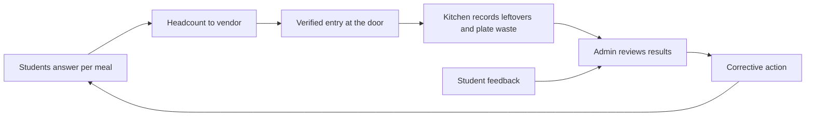
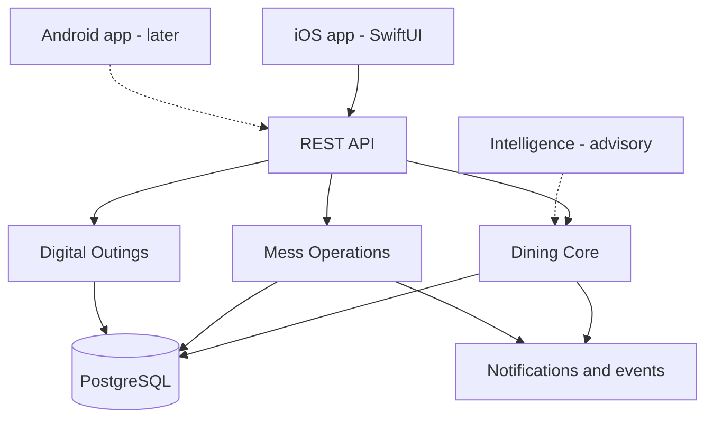
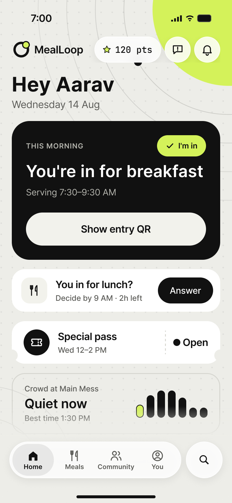
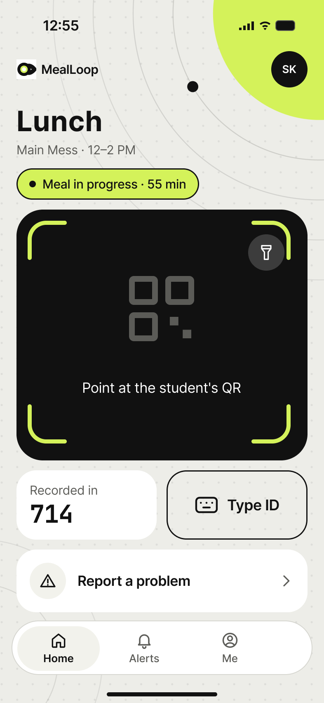
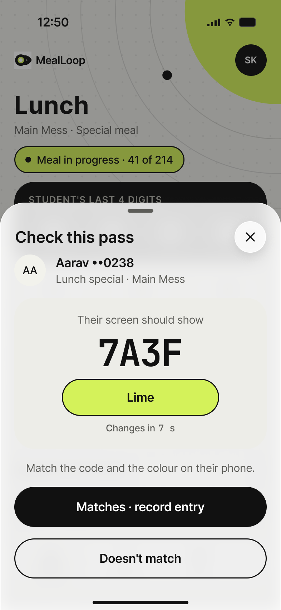
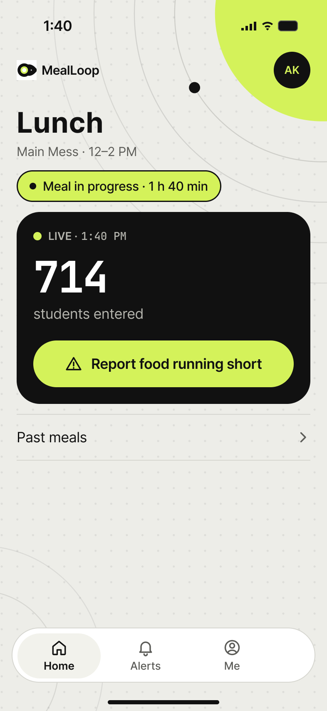
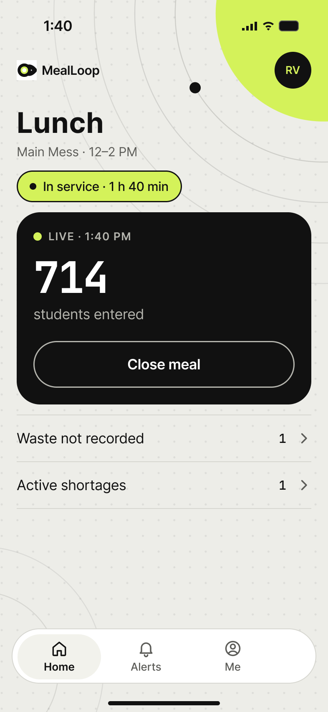
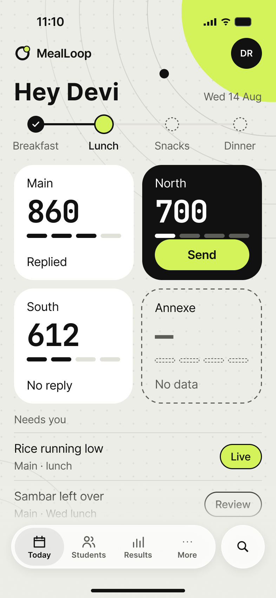

# MealLoop

**Meal planning, verified attendance and accountable feedback for institutional dining.**

MealLoop is an AI-assisted institutional dining and student-engagement platform. It is designed to improve meal-demand planning, reduce avoidable food waste, manage crowding at the mess and make student feedback lead to visible corrective action. It connects students, door and desk staff, kitchen workers, supervisors and administrators through one operational system.

> **Status in one line:** this repository currently contains the product design, the Figma prototype documentation and design audit records. It does not yet contain a runnable app, a backend or tests. See [Current status](#current-status).

---

## Contents

- [Overview](#overview)
- [The problem](#the-problem)
- [How MealLoop works](#how-mealloop-works)
- [Features](#features)
- [Role-based experiences](#role-based-experiences)
- [AI and intelligence](#ai-and-intelligence)
- [Architecture and technology](#architecture-and-technology)
- [Current status](#current-status)
- [Pilot and roadmap](#pilot-and-roadmap)
- [Design and prototype reference](#design-and-prototype-reference)
- [Getting started](#getting-started)
- [Team and contributions](#team-and-contributions)
- [Open decisions and limitations](#open-decisions-and-limitations)

---

## Overview

MealLoop is not an attendance app, a Google Form replacement, a food-waste dashboard, a QR scanner or a chatbot. It is one system in which each part feeds the next:

**Better student participation → more useful demand signals → better meal planning → verified operational outcomes → corrective action → continuous improvement.**

- **Students** say whether they will eat each meal, see menus and crowd guidance, report problems and follow what happened to them.
- **Mess staff** verify entry at the door and at the special-meal pass desk, report shortages, and record leftovers and plate waste after the meal.
- **Supervisors** run the meal for their mess, follow up shortages and close safety (SOS) cases.
- **Administrators and the food head** send the vendor a headcount, review results against verified attendance, act on feedback and track whether a change actually worked.

### Principles

- **Student value first.** Menus, meal plans, crowd guidance, problem reports with visible follow-up, community-supported improvements, credits, and a more convenient digital outing workflow for eligible students.
- **Operational usefulness.** Reduce administrative work; do not add data-entry burden for staff.
- **AI with a purpose.** Used only where it improves predictions, feedback analysis or decisions.
- **Data integrity.** MealLoop always keeps these apart:
  - intentions vs verified attendance;
  - live vs final entries;
  - forecast vs confirmed headcount;
  - food produced vs served vs left over vs plate waste;
  - a missing measurement vs a measured zero;
  - predicted vs verified crowd;
  - an AI suggestion vs an authorized human decision.
- **Accountability.** Headcount overrides, incident resolution and key decisions are traceable, with a reason and a history.

## The problem

Institutional messes cook for hundreds or thousands of students without knowing in advance who will eat. That leads to food left over on some days and shortages on others, queues at peak times, and feedback that disappears without any visible response.

At the planned pilot mess there is currently no collection of meal intentions and no student entry-scanning system. MealLoop proposes per-meal intentions from students, plus QR-based entry verification so that plans can be compared with what actually happened.

## How MealLoop works

1. Before each meal, students answer **I'm in**, **Skip** or **Not sure**. The planning cutoff is **two hours before the meal**.
2. Management sends the vendor a **headcount**, not dish quantities.
3. At the door, staff scan each student's **entry QR**. The QR is always available, even to students who skipped or did not answer. **Nobody is denied food for not answering.**
4. During the meal, the kitchen and the supervisor see the live count of students who have entered. Shortages go to the supervisor.
5. After the meal, the kitchen records leftovers per dish and one plate-waste total.
6. Admins compare the headcount sent with final verified attendance, shortages and waste. They look at likely causes and try corrective changes. A change counts as having worked only once comparable meals show it.
7. Student feedback runs through the same loop: reports are grouped and reviewed, actioned by the right staff, and followed up with the student.



## Features

### Meal planning and headcount

- Published menus for Breakfast, Lunch, Snacks and Dinner.
- Per-meal answers: I'm in / Skip / Not sure, with reminders and optional reasons for skipping. Cutoff two hours before the meal.
- Admins can adjust the final headcount; every adjustment needs an explanation and is kept in the audit history.
- The university sends the vendor a **headcount only**. There is no vendor app, no procurement module and no automatic dish-quantity plan.

### Attendance verification

- **QR entry confirms entry.** It does not prove that food was served or eaten.
- Door staff scan the entry QR. They detect repeat scans, handle invalid or wrong-meal codes, use the manual fallback (the last 4 digits of the SRM ID) and report problems.
- A student who did not answer is still recorded at entry, and is added automatically to a separate **"Entered without voting"** list. This is not a vote.
- An offline or unverifiable scan is **never shown as success**, and nothing is recorded.
- The backend can compare each student's final intention, the verified entry and the meal total.

### Credits and incentives

- Credits are planned for **participation** (a useful answer before the cutoff) and **accuracy** (the answer matched a reliably verified outcome).
- Yes and No are both valid answers. Students must not be pushed to say Yes. Genuine corrections before the cutoff are supported.
- Scanner failures need a correction process. Credits must not depend solely on AI, and duplicate redemptions are prevented.
- **The formula, thresholds and rewards are not finalized.** Any point values in the design are samples.

### Crowd management

- Entry timestamps give arrival patterns in 5- or 15-minute buckets, recurring peaks, comparisons with history and likely quieter periods. Each is shown with its freshness and confidence.
- The MVP does not assume reliable exit detection. Cumulative entries are not current occupancy, and any occupancy estimate is labelled as an estimate.
- Future research only: dining-duration models, BLE, privacy-conscious overhead counters. GPS geofencing is not claimed to detect indoor exits.

### Intelligent feedback

> **Under owner review.** The flow below is the earlier documented flow. The owner's latest text differs on who publishes to Community and on the role of a language model. See [`docs/PRD.md`](docs/PRD.md) (FR-FB-005, FR-AI-008) and Conflicts C-1 and C-2 in [`docs/OPEN_DECISIONS.md`](docs/OPEN_DECISIONS.md#conflicts). Neither version is final until the owner confirms.

<details>
<summary>How a report becomes corrective action</summary>

```text
Student → Admin (with SLM assistance) → Community → support threshold
        → Admin → relevant staff → corrective action → student follow-up
```

- A small language model (SLM) groups similar reports, summarizes them, separates actionable from subjective feedback and suggests actions. It **never** rejects a complaint, declares food safe or authorizes action.
- The admin decides what is published to Community. Students back issues with **Me too**; each eligible student counts once. The support threshold is undecided.
- Nothing is marked Fixed just because an admin pressed a button. The system records who owned the issue, what was investigated, what was done and when, and whether students later reported improvement.
- Urgent hygiene, contamination or illness reports use the separate **SOS** workflow and never wait for voting.

</details>

### Mess operations

Door Scanner, Pass Desk, Kitchen Staff and Supervisor roles are described in [Role-based experiences](#role-based-experiences).

SOS is shared across these staff roles. A right-edge tab appears only while an SOS is active. Staff can claim a case ("I'll go and check") and mark it checked, which does not close it. Only the Supervisor closes a case.

### Food head and admin

<details>
<summary>Admin areas (tabs: Today, Students, Results, More)</summary>

- **Today:** status per mess: forecast, headcount sent, vendor reply, meal progress and urgent items.
- **Students:** participation, feedback needing action, Community issues and reminders.
- **Results:** headcount sent vs final verified attendance, shortages, dish-wise leftovers, plate waste and missing evidence. Likely causes are tagged **Sure**, **Probably** or **Can't tell**, never as percentages.
- **Corrective-action review:** a change cannot be marked as having worked until at least two comparable meals are recorded.
- **Menu management:** photo upload, OCR/vision extraction, flagging of uncertain readings, manual correction, publishing, and notifying students of significant changes.
- **Also:** weekly and monthly reports with PDF/CSV export, rewards, special-pass oversight, staff access, safety cases and audit history.

</details>

### Digital outings

An optional, more convenient digital alternative to SRM's existing outing process. It is for students who meet participation and reliability requirements; that formula is not approved, and other students keep using the existing process.

```text
request → guardian verification → warden decision → pass issued
        → gate verifies exit → gate records return → overdue returns escalated
```

- An outing approval does not prove that the student left. Only verified gate events count as attendance-related evidence.
- **Guardian verification:**
  - Slide-to-approve is replaced by a 10-second live video in which the guardian says a phrase containing a random code. The guardian's face is always captured.
  - If automatic checking fails, there are three fallbacks:
    - the video still goes to the warden, marked "please watch";
    - a live photo plus the typed phrase and a code sent to the guardian's phone;
    - the warden phones the guardian.
  - Text-only confirmation is not allowed.
  - This is evidence, not proof. Privacy, institutional approval, language support (English, Tamil and Hindi first) and the retention period (draft: 30 days) are not yet approved.

## Role-based experiences

| Role | What they do | Key rule |
|---|---|---|
| Student | Answers I'm in / Skip / Not sure; shows the entry QR; reads menus and crowd guidance; reports problems; supports Community issues; uses credits; requests outings | The entry QR is always available; nobody is denied food for not answering |
| Door Scanner | Scans entry QRs, or types the last 4 digits of the SRM ID; reports door problems; can claim an SOS | No decline step and no supervisor approval; an offline scan records nothing and never shows success |
| Pass Desk | Checks the special-meal pass (separate from hostel outing passes): types the last 4 digits, compares the code and colour shown with the student's phone, then taps "Matches · record entry"; requests pass reissues | The desk does not scan; a lookup alone never records an entry; "Approved" is never shown as "Done" |
| Kitchen Staff | Sees forecasted attendance before the meal and the live entered count during it; reports shortages; records leftovers per dish (kg, L or pieces) and one plate-waste total after the meal | Missing data never becomes zero; a saved report is simply Recorded and can be edited for 6 hours |
| Supervisor | Starts and closes the meal for the mess; resolves shortages; sees recorded waste read-only; closes SOS cases | Starting or closing a meal drives the meal state of every staff role in that mess; there is no "forward to Admin" action |
| Admin / Food head | Sends the vendor a headcount; reviews results; manages menus, feedback, Community, rewards, special passes, staff access and safety cases | Headcount only to the vendor (no dish quantities, no vendor login); causes shown as Sure, Probably or Can't tell |
| Guardian, Warden, Gate | Guardian video approval; warden decision; gate exit and return | An approval is not proof of leaving; only gate events count |

<details>
<summary>More detail on the staff roles</summary>

- **Door Scanner:** shows Entry recorded, Already scanned, QR not recognised, Wrong meal and Can't check right now. A student with no meal response goes on the "Entered without voting" list automatically. When the door checks an SOS case it is marked "Checked by the door"; that does not close it.
- **Pass Desk:** the special pass shows a live code and colour that keep changing. The desk app shows what the student's phone should be showing right now; staff compare the two. Reissue requests go to the existing admin pass-exception flow. "Done" means the student actually has the new pass. Camera scanning would need a QR on the student pass and is not part of the current design.
- **Kitchen Staff:**
  - **Before the meal:** "Forecasted attendance" with the expected diners.
  - **During:** only the live count of students who have entered. Never meals served, and never the forecast beside it.
  - **After the meal only:** record leftovers. Each field is entered, "None left" (a confirmed zero), "Not made" or not entered.
  - Meals that ended without a report show "Not recorded". Shortages go to the Supervisor, and the status row never claims "seen" without evidence.

</details>

## AI and intelligence

AI in MealLoop is **advisory** unless a specific low-risk operation is explicitly approved. Core dining workflows must keep working when AI is unavailable. Screens show uncertainty and data limits.

| Area | What it is meant to do | What it never does |
|---|---|---|
| Demand forecasting | Learn from verified attendance, intentions, meal type, weekday, the academic calendar, exams and holidays, and confirmed outings. Start with a statistical baseline; compare any ML model against it using time-based evaluation | Claim accuracy without evidence |
| Crowd intelligence | Predict arrival patterns from QR entry timestamps | Report exact occupancy or waiting time without validation |
| Feedback intelligence | Group reports, summarize them and suggest actions (structured complaints may need only aggregation) | Reject a complaint, declare food safe or authorize action |
| Waste and shortage analysis | Compare forecast with actual; spot repeated leftovers, dish-specific complaints, shortages and timing anomalies | Treat correlation as causation |
| Menu extraction | Read a menu photo with OCR/vision | Publish uncertain items without human verification |

The Figma design contains AI-related screens. **That does not mean any AI is built.** No models, training data, evaluation results or predictions exist in this repository.

## Architecture and technology

**Team strategy:** SwiftUI first → shared backend → Android later.

**Proposed stack (planned, not proof of implementation):**

- **Apps:** Swift / SwiftUI for iOS; Kotlin / Jetpack Compose for Android later.
- **Backend and data:** Java with Spring Boot; PostgreSQL; Python for ML where appropriate.
- **Infrastructure:** Docker and Docker Compose; REST/JSON APIs described with OpenAPI.
- **Quality:** GitHub Actions and automated tests.

**Domain boundaries:** Dining Core, Mess Operations, Intelligence, Digital Outings, and background notifications/events.



**Design notes:**

- Start modular; split into separate services only when there is a clear need.
- Docker alone does not provide resilience. Isolation needs data ownership, timeouts, durable events and failure testing.
- Degrade gracefully:
  - AI down → QR entry and operations continue.
  - Push notifications down → records still save and notifications retry.
  - Outings down → dining continues.
  - Feedback AI down → submissions still work.

**Development approach:** vertical slices.

1. Understand the workflow.
2. Define the data and API.
3. Build the SwiftUI screens and the backend together.
4. Integrate with persisted data.
5. Test failure and permission cases.
6. Review through pull requests.

The Figma design is a reference, not proof of implementation.

**Demo data policy:** seeded data is allowed, but it must be:

- explicitly labelled;
- kept apart from pilot data;
- never presented as measured results;
- never silently included in production analytics.

## Current status

Checked against the repository contents on the current branch. No `*.xcodeproj`, `Package.swift`, `*.swift` files, backend folder, `docker-compose.yml`, `pom.xml`, `build.gradle`, tests or CI workflows exist. The `.js` and `.py` files under `design/audit/tools/` are Figma audit and build scripts, not application code.

| Area | Designed in Figma / prototype | Implemented in code | In development | Planned |
|---|---|---|---|---|
| Student app (answers, menus, entry QR, Community, feedback, SOS, credits) | ✓ | – | – | ✓ |
| Door Scanner | ✓ | – | – | ✓ |
| Pass Desk | ✓ | – | – | ✓ |
| Kitchen Staff | ✓ | – | – | ✓ |
| Supervisor | ✓ | – | – | ✓ |
| Admin / Food head (Today, Students, Results, More) | ✓ | – | – | ✓ |
| Digital outings (student, guardian video, warden, gate) | ✓ | – | – | ✓ |
| Backend, database and shared meal state | Simulated in the prototype only | – | – | ✓ |
| AI: forecasting, crowd, feedback, menu extraction | UI surfaces only | – | – | ✓ |
| Android app | – | – | – | ✓ |

"In development" is left empty because nothing in the repository shows active implementation work. Cross-role behaviour such as shared meal state, scan results and SOS routing is **simulated** in the Figma prototype with hidden hotspots and labelled "Simulated:" notes.

## Pilot and roadmap

**Pilot scope:**

- **Institution:** SRM Institute of Science and Technology, Kattankulathur. The institution has indicated cooperation; this is an indication, not a signed agreement.
- **Initial pilot location:** Meenakshi Girls' Mess, which has a common entrance and exit doorway.
- **Starting point:** no meal-intention collection and no student entry scanning exist at the pilot mess today. MealLoop proposes QR-based verification.
- **Out of scope:** the boys' hostel has an existing Face ID attendance system; integrating it is outside the initial pilot.
- **Not yet happened:** the pilot has not been deployed, and no waste reduction has been measured.

**Milestones:**

| When | Milestone | Target |
|---|---|---|
| 11–13 Nov 2026 | External Review 3 | MVP without a backend: strong SwiftUI, a coherent cross-role demo, the important interactions working, clearly labelled seeded data |
| 27–29 Jan 2027 | External Review 4 | Core dining features integrated, working backend and database, secure attendance verification, operational workflows, the feedback and Community loop, initial intelligence |
| Feb–Mar 2027 | Pilot | Where institutionally authorized: real measurements, evaluation, refinements |
| 8–9 Apr 2027 | External Review 5 | |
| 16 Apr 2027 | App Fair | |

Android stays on the roadmap and is not built.

## Design and prototype reference

- **Figma file:** [MealLoop](https://www.figma.com/design/nzzTAm9YnJRSdKEeYUWUEb/MealLoop). The prototype has 14 flow starts (student, mess staff, admin, admin redesign, guardian, warden and gate), as listed in [`STATE.md`](design/audit/STATE.md).
- **All screens use sample data and placeholder names** (for example "Main Mess", sample students and sample counts such as 860, 714 and 774). These are illustrations, not measured results.

**Key documents:**

| Document | What it holds |
|---|---|
| [`design/README.md`](design/README.md) | Figma page map, visual direction and earlier design rounds |
| [`design/audit/PROJECT_CONTEXT.md`](design/audit/PROJECT_CONTEXT.md) | Handoff context: roles, components, decision log, lessons |
| [`design/audit/design_intent.md`](design/audit/design_intent.md) | Rules, definitions and per-role decisions (latest sections at the end) |
| [`design/audit/STATE.md`](design/audit/STATE.md) | Short "where are we" card, newest run first |
| [`design/audit/MASTER_CONTEXT.md`](design/audit/MASTER_CONTEXT.md) | Outing Pass module and student redesign summary |
| [`design/audit/DEMO.md`](design/audit/DEMO.md) | Step-by-step prototype walks per role |
| [`design/audit/prototype_gaps.md`](design/audit/prototype_gaps.md) | Numbered open gaps and owner items |
| [`design/audit/still_absent.md`](design/audit/still_absent.md) | Controls whose destination screen does not exist yet |
| [`design/audit/run_status.md`](design/audit/run_status.md) | Run-by-run log |

<details>
<summary>Reference packs (layout and copy references for each redesign)</summary>

| Pack | Rules and wording |
|---|---|
| [Student redesign](design/reference/redesign_2026-10/README.md) | [Mess menu transcription](design/reference/redesign_2026-10/data/mess_menu_2024-08-12.md) |
| [Admin redesign](design/reference/admin_redesign_2026-10/README.md) | [Admin sample data](design/reference/admin_redesign_2026-10/data/admin_sample_data.md) |
| [Door Scanner](design/reference/door_scanner_2026-10/README.md) | [Spec](design/reference/door_scanner_2026-10/data/door_scanner_spec.md) |
| [Pass Desk](design/reference/pass_desk_2026-10/README.md) | [Spec](design/reference/pass_desk_2026-10/data/pass_desk_spec.md) |
| [Kitchen Staff](design/reference/kitchen_2026-10/README.md) | [Spec](design/reference/kitchen_2026-10/data/kitchen_spec.md) |
| [Supervisor](design/reference/supervisor_2026-10/README.md) | [Spec](design/reference/supervisor_2026-10/data/supervisor_spec.md) |
| [Guardian video](design/reference/guardian_2026-10/README.md) | [Spec](design/reference/guardian_2026-10/data/guardian_video_spec.md) |
| [Fix 2](design/reference/fix2_2026-10/README.md) | – |
| [Polish](design/reference/polish_2026-10/) | – |

</details>

**Exported screens:** 594 PNG files across 12 `design/audit/export*/` folders (counted on this branch). A few examples (sample data):

<p>
  
  
  
  
  
  
</p>

## Getting started

There is nothing to build or run yet. The repository currently holds the design and its documentation; start with the Figma file and [`design/audit/DEMO.md`](design/audit/DEMO.md).

## Team and contributions

MealLoop is built by a team of four developers, most of whom are learning native iOS development, with Claude Code as an assistant. Work happens on branches and is reviewed through pull requests. When contributing:

- Follow the latest decisions in [`design/audit/design_intent.md`](design/audit/design_intent.md).
- Keep sample data labelled as sample.
- Never present a designed or simulated flow as working functionality.

## Open decisions and limitations

**Open decisions (not yet answered; nothing here should be treated as decided):**

- Credit/reward formula and eligibility window.
- Community "Me too" support threshold.
- Digital-outing eligibility formula.
- Guardian verification source.
- Guardian-video policy: privacy, institutional approval, language support and the retention period (draft: 30 days).
- Whether students answer for Snacks.
- The meaning of the yellow highlight on the printed menu.
- Who the `**` gravies on the menu are for.
- Vendor channel: WhatsApp, call or SMS.
- Offline policy for scanning (draft: never record).
- How long a missed meal's waste can still be recorded.

**Limitations:**

- No application code, backend, database, tests or CI exist in this repository yet.
- All cross-role behaviour in the prototype is simulated.
- Every number in the design is sample data. Some screens and older documents show sample cutoff times (for example "Decide by 9 AM") that predate the two-hours-before-the-meal rule.
- Some older documents in `design/` describe earlier decisions that the latest decisions replace, for example:
  - a kitchen "recommended plan";
  - supervisor plan changes;
  - "Hold to Confirm" for the special pass;
  - slide-to-approve for guardians;
  - the older admin tabs Today, Issues, Insights and Manage.

  Where documents disagree, the newest decision wins.
- The Dark-mode student page in Figma is marked stale and was not rebuilt with the redesign.
