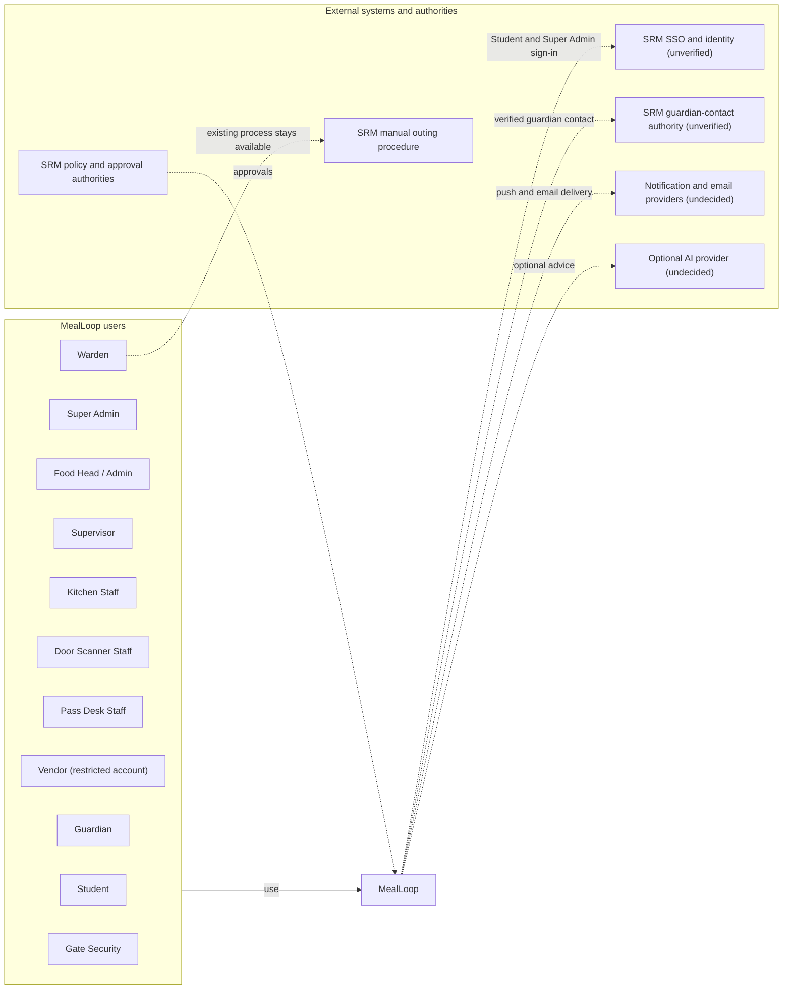
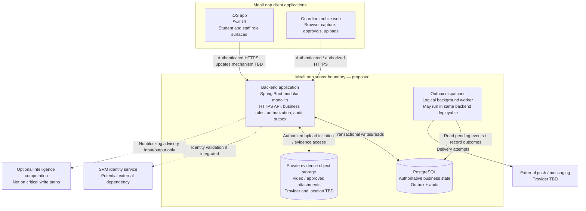

# MealLoop — C4 Architecture (Review Draft)

**Version:** 0.3 · **Date:** 2026-10-24 · **Overall status:** the architecture is STILL UNDER REVIEW and is not implemented. Only C1 is owner approved.

**Review sequence:** PRD → NFR → C1 → C2 → C3 → selective C4 → ADRs → data model and API contracts  
**First pilot:** Meenakshi Girls' Mess, SRMIST Kattankulathur

| Document control | Status |
|---|---|
| **C1 — System Context** | **OWNER APPROVED — 24 October 2026** (see [C1 owner approval](#c1-owner-approval)) |
| **C2 — Container** | UNREVIEWED DRAFT |
| **C3 — Component** | NOT STARTED |
| **C4 — Code** | SELECTIVE / DEFERRED |
| **Overall architecture** | STILL UNDER REVIEW |

> This is an architecture proposal informed by [PRD v0.3](../PRD.md) and [NFR v0.3](../NFR.md). Both are still review drafts under owner review and are not owner-approved. Do not present proposed infrastructure or external integrations as deployed, confirmed, or institutionally authorized. The existing [ADR-002](../adr/ADR-002-backend-shape.md), [backend proposal](../backend/BACKEND_PROPOSAL.md), and [first-slice OpenAPI](../backend/openapi.yaml) remain proposals, not decisions approved by this document.

## What C1 / C2 / C3 / C4 mean

| Level | Question answered | Status in this draft |
|---|---|---|
| **C1 — System Context** | Who uses MealLoop, and what systems does it interact with? | **Owner approved — 24 October 2026** ([record](#c1-owner-approval)) |
| **C2 — Container** | Which independently deployable applications and data stores form MealLoop? | **UNREVIEWED DRAFT below; not approved, not reviewed and not expanded in this revision** |
| **C3 — Component** | Which components/modules inside the backend own each business operation and boundary? | **Not started** |
| **C4 — Code** | How do classes, interfaces and code collaborate inside a selected component? | **Selective and deferred; optional for complex components** |

"C4 model" is the name for all these views. A full class-level diagram is **not** a prerequisite for every feature. A C4 *container* means an application or data store that can execute or deploy separately, not a Docker container.

## C1 — System context

### C1 owner approval

The repository owner explicitly approved **C1 — System Context** on **24 October 2026**. Approved diagram (editable, Eraser): [C1 — System Context](https://app.eraser.io/workspace/dtLAj6uiBc7Gl2OndSW2?diagram=mfEHZZ5nqX1EL8ZrddzQ&layout=canvas). The Mermaid diagram below is the in-repository equivalent.

Approved C1 decisions:

1. Students and Super Admins use SRM SSO, subject to SRM IT integration feasibility.
2. Other operational users (Food Head / Admin, Supervisor, Kitchen Staff, Door Scanner Staff, Pass Desk Staff, Warden, Gate Security) and the Vendor have individual MealLoop-managed accounts.
3. Super Admin manages account provisioning and permissions; Food Head / Admin has separate operational responsibilities and no Super Admin privileges.
4. The Vendor is a restricted MealLoop user, not an external vendor API integration.
5. The Vendor sees approved headcounts and authorized updates for its assigned mess and acknowledges receipt.
6. Notifications may use external providers, but MealLoop retains the authoritative event records.
7. Guardian authority comes from institutionally verified contact information or an approved correction.
8. The existing manual outing procedure remains available.

**Limits of this approval.** Owner approval of these system boundaries is **not** SRM approval, **not** production-readiness certification and **not** verification that any external integration is available. SRM SSO feasibility, the guardian authentication mechanism, the notification provider, hosting and provider choices, vendor acknowledgment rules (deadline, escalation, fallback, and whether a later update supersedes an earlier acknowledgment) and guardian-evidence privacy policy all remain open (see [`OPEN_DECISIONS.md`](../OPEN_DECISIONS.md)). Approving C1 does not approve C2, C3, C4, ADR-002, the backend proposal, the OpenAPI draft or any backend technology.

**Pending correction to the Eraser artifact (not applied).** The approved Eraser diagram labels the Supervisor relationship "Start and close meals, record shortages and SOS". The accurate wording is: the Supervisor starts and closes meals, resolves shortages and handles SOS incidents (OPEN_DECISIONS R6). This document uses the corrected wording; the Eraser diagram was deliberately not edited and still needs an owner-authorized label change. Its legend also reads "confirmed direction" versus "unverified or institutional dependency"; the legend below is the authoritative wording.

### People and external systems

**Internal actors (MealLoop users).** Every internal actor, including the vendor, is a user of MealLoop with a MealLoop identity.

- **Student:** views the menu, submits meal intentions, shows the entry QR, reports issues, views eligible credits, requests outings.
- **Super Admin:** a separate role for system-level identity and institutional configuration: account provisioning, role assignment, scope changes, account deactivation and password-reset initiation. The detailed permission matrix is OPEN. Super Admin cannot read any user's password.
- **Food Head / Admin:** manages operational mess workflows (headcount approval and handoff to the vendor, menus, reports). Does **not** have Super Admin privileges.
- **Supervisor:** starts and closes the meal for the mess, resolves shortages and handles SOS incidents, within their assigned mess.
- **Kitchen Staff, Door Scanner Staff, Pass Desk Staff:** mess operations, within their assigned mess.
- **Vendor (restricted account):** signs in to its own restricted MealLoop account, views the approved headcount for its assigned mess and any authorized update, and acknowledges receipt. The vendor is **not** an external system and there is **no direct vendor API**. The vendor receives an approved headcount only.
- **Guardian:** reviews and accepts or rejects an outing request via mobile web; acceptance starts the separately handled verification evidence. Guardian authentication is an unresolved design problem.
- **Warden and Gate Security:** scoped to their authorized hostel or block and outgoing pass events.

**External systems and institutional authorities.**

- **SRM SSO and identity infrastructure (unverified):** the intended sign-in source for Students and Super Admins. **SRM SSO feasibility is unverified.** No protocol, client registration, user attributes or administrative API is assumed to exist, and no fallback identity scheme is approved.
- **SRM institutional guardian-contact authority (unverified):** the source of a verified guardian contact record, or of an institutionally authorized correction. A student cannot replace guardian contact information and immediately create a new approver.
- **External notification and messaging providers (provider undecided, unverified):** deliver push or other institutionally authorized messages, including email for account invitations and password resets. MealLoop keeps the authoritative notification and event record.
- **SRM's existing manual outing procedure:** remains available for ineligible students and wherever digital outings are not authorized.
- **SRM policy and approval authorities:** institutional approval of identity-verification methods, video retention, consent, access delegation, outing policy, rewards and pilot rollout.
- **Optional AI or model provider (undecided):** advisory only; shown in C1 only because the C2 draft already lists optional intelligence.

**Note (not in C1).** The Phase 2 RFID and camera return station is a proposed item and is outside the scope of C1 and of the December target.

### Context diagram

Solid arrows are direct use. Dashed arrows are unverified integrations or institutional dependencies. MealLoop is drawn as one system.

**Legend.** Solid line: a confirmed relationship, where users use MealLoop. Dashed line: an unverified integration or an undecided or institutional dependency; it must not be read as an existing or available integration. "Confirmed direction" in the table below means the owner approved the boundary, not that the integration exists.

| Actor or external system | What it does | How it authenticates | Status |
|---|---|---|---|
| Student | Meal answers, entry QR, reports, credits, outing requests | SRM SSO | Confirmed direction; SSO feasibility unverified |
| Super Admin | Account provisioning, role assignment, scope changes, deactivation, password-reset initiation; cannot read passwords | SRM SSO | Confirmed direction (separate role); SSO feasibility unverified; detailed permission matrix open |
| Food Head / Admin | Headcount approval and handoff, menus, reports; no Super Admin privileges | MealLoop-managed account (email and password) | Confirmed direction |
| Supervisor | Starts and closes meals, resolves shortages, handles SOS incidents | MealLoop-managed account | Confirmed direction |
| Kitchen Staff | Counts, shortages, waste reports | MealLoop-managed account | Confirmed direction |
| Door Scanner Staff | Entry scanning | MealLoop-managed account | Confirmed direction |
| Pass Desk Staff | Special-pass checks | MealLoop-managed account | Confirmed direction |
| Vendor (restricted account) | Views the approved headcount and authorized updates for its assigned mess; acknowledges receipt | MealLoop-managed account | Confirmed direction; acknowledgment rules, deadline, escalation and fallback open |
| Guardian | Accepts or rejects an outing request; video evidence | To be decided | Open; guardian authentication unresolved |
| Warden | Final outing decision, scoped to own block | MealLoop-managed account | Confirmed direction |
| Gate Security | Records gate exit and return | MealLoop-managed account | Confirmed direction |
| SRM SSO and identity infrastructure | Intended sign-in for Students and Super Admins | Not applicable | Unverified |
| SRM guardian-contact authority | Verified guardian contact records and authorized corrections | Not applicable | Unverified |
| Notification and email providers | Deliver push, invitation and reset messages | Not applicable | Provider undecided; unverified |
| SRM manual outing procedure | Existing outing process | Not applicable | Existing; remains available |
| SRM policy and approval authorities | Approve identity methods, retention, consent, access delegation, outing policy, rewards | Not applicable | Approvals required |
| Optional AI provider | Advisory computation | Not applicable | Undecided |

**System boundary:** MealLoop owns its product records, authorizations, audit history, and outcomes that its server commits. It does **not** own the vendor's food-production process, guardian's real-world identity, SRM's policies, the campus network, or the external notification provider.

### Context constraints

1. Student intention is not attendance; a QR entry confirms entry, not food served or consumed (PRD DI-1, DI-3, DI-7).
2. Live forecast, Cutoff forecast, Approved headcount, Sent (published-to-vendor) headcount, Actual entries and Final entries are separate facts (FR-HC-002).
3. AI cannot independently grant safety permissions or block core dining (NFR-REL-008).
4. No offline scan or pass check is represented as a digitally recorded success during the pilot (NFR-REL-001, NFR-REL-005); authorized manual continuity is **separate**, with audited reconciliation.
5. Outing activation, guardian video collection, retention and real reward redemption remain subject to SRM approval (NFR-DEP-004).
6. Initial digital outing **pilot eligibility** covers the SRM-authorized cohort without participation/reliability enforcement; post-pilot eligibility requires both based on validated evidence (FR-OUT-024, FR-OUT-028).
7. Identity has two arrangements: SRM SSO for Students and Super Admins (feasibility unverified) and individual MealLoop-managed accounts for all other internal users, including the vendor (FR-ID-001, FR-ID-002). Production actions are individually attributable (FR-ATT-015). The shared four-digit role password is a prototype interaction only (FR-ATT-013).
8. An external delivery result is never equivalent to human acknowledgment, and a vendor acknowledgment is never fabricated (FR-VEN-003, NFR-REL-009). If external delivery fails, the committed operation stays saved, the in-app alert stays accessible and the failure is recorded; the retry and escalation policy is OPEN.
9. Guardian authority comes from an SRM-verified contact record or an institutionally authorized correction. A student cannot replace guardian contact information and immediately create a new approver. Control of a phone number or a successful live video is not proof of guardian identity. The guardian-first, warden-second sequence is unchanged.

## C2 — Container view

> **UNREVIEWED DRAFT.** This preliminary container proposal has not been reviewed or approved by the owner, and it is not expanded in this revision. The Spring Boot and PostgreSQL choices are proposals only, not accepted decisions. C1 is now owner approved; C2 still awaits owner review.

**Proposed shape:** one Spring Boot backend deployable with clear internal modules and one PostgreSQL database. This fits the four-person team and one-mess pilot better than mandatory microservices. The architecture remains a proposal until evaluated in ADRs.

### Container diagram

### Container responsibilities and boundaries

| Container | Responsibility | Important restrictions | Decision status |
|---|---|---|---|
| **SwiftUI iOS application** | Role-specific interfaces, accessibility, request and state presentation, demo/API switch | Never commit attendance locally; no protected decision based on device clock; no demo data in release | Client foundation exists; backend integration unimplemented |
| **Guardian mobile web** | Request review, Accept/Reject, chosen-language video capture, interrupted-upload recovery | Verification evidence is not proof of identity; cannot bypass warden; must not publicize media | Proposed application boundary; privacy and browser matrix pending |
| **Backend application** | Identity and scoped authorization, state machines, transactional commands, reporting/query APIs, audit, event recording | No shared four-digit staff password as sole production identity; no synchronous AI dependency in core transactions | Proposed Spring Boot monolith |
| **PostgreSQL** | Canonical records, uniqueness and integrity constraints, audit metadata, outbox | Incomplete data never coerced to zero; approved/forecast/sent/actual/final quantities do not alias | Proposed |
| **Private object storage** | Guardian video and approved attachments | Backend-authorized access only, encryption, retention/deletion policies; location and provider need approval | Proposed; not selected |
| **Outbox dispatcher** | Delivery attempts, retry/backoff, failure tracking, routing/escalation | At-least-once attempts; consumer deduplication; a failed push never deletes the originating event | Logical component; deployment location TBD |
| **Optional intelligence** | Forecast comparisons, optional advisory classification and analysis | Core transactions do not depend on it; no autonomous approval or eligibility determinations | Optional / may remain absent |

**Not asserted:** iOS support for every administrative workflow, hosting provider, autoscaling, broker, Redis, WebSockets, SMS vendor, storage region, hardware scanner integration, or completed integrations.

### Important system sequences (proposed, technology-independent)

**Verified meal entry:**
1. A staff member submits a scan/identifier through the iOS client.
2. Backend authenticates the staff member and validates permission **and assigned mess**.
3. Backend checks the meal's current authoritative state, QR/identity proof and duplicate-entry invariant.
4. One database transaction saves the accepted record and any required auditable event; the unique key prevents concurrent double-counting.
5. Only the successful committed response can display **Recorded**. A timeout may require an idempotent status check before retry; it is never assumed failed or successful.
6. Staff read models and notifications update subsequently. Stale interfaces cannot override server state.

**Admin headcount and vendor handoff (the vendor is a MealLoop user):**
1. The Food Head reviews the forecast; the live forecast and the cutoff forecast are preserved.
2. The Food Head approves or adjusts a separately recorded headcount with an audit reason. It is never approved automatically.
3. MealLoop makes **that approved headcount** available to the authorized vendor account for the assigned mess. There is no direct vendor API.
4. The vendor signs in, views the approved headcount and any later authorized update, and acknowledges receipt.
5. MealLoop stores the publication and the acknowledgment history with actor and time. Publishing is never acknowledgment; a missing acknowledgment is shown as pending, and an acknowledgment is never fabricated.
6. Actual and final entry counts remain independent. The existing message or call handoff remains the designed interim handoff.

**Guardian outing:**
1. Student request → verified guardian access → Accept or Reject.
2. Only Accept starts the 4–10-second video/verification flow, with supported fallback review.
3. Guardian response and its evidence are stored with scoped access and audit.
4. The assigned authorized Warden makes the final approval decision; no timeout auto-approves.
5. Signed time-limited pass → authoritative Gate exit and return verification. Exact token/security design is deferred.

**SOS and notifications:**
1. Persist SOS case and delivery intent in authoritative records.
2. Make it visible through server queries to assigned staff; attempt notification separately.
3. Distinguish event persistence, UI visibility, provider delivery attempt, human acknowledgment and escalation.
4. Failed notification delivery must not erase the SOS; the failure is recorded and the in-app alert stays accessible. A delivery result is never human acknowledgment. Retry and escalation policy, SOS escalation targets and provider choices are OPEN. Urgent real-world danger must retain institutionally approved emergency channels independent of the app.

### Questions for the C2 review raised by the C1 decisions

These are questions only. Nothing here is a design, and none is approved.

- Is identity an internal module, and how does it federate with SRM SSO if SSO access is confirmed, and how are MealLoop-managed accounts handled in the meantime?
- How is vendor-scoped authorization enforced for one assigned mess, with no access to student-level data?
- Where is the headcount publication and acknowledgment record owned, and how are updates and re-acknowledgments represented?
- How is the email and notification provider integrated (account invitations, password resets, push), and how are delivery failures recorded?
- How is account administration audited (provisioning, role and scope changes, deactivation, reset initiation)?
- How does the guardian page authenticate a guardian, given that phone control and live video are not proof of identity?

## C3 — Next design pass (NOT yet accepted)

Proposed **internal** backend component/module candidates; these are NOT C2 deployment containers:

1. **Identity & Access:** principal/session, role assignment, mess/block policy, resource authorization, delegation.
2. **Dining Core:** meals, intentions and cutoff, forecast versions, headcount approval/handoff, attendance entries and special passes.
3. **Mess Operations:** start/close commands, shortages, SOS, waste reports, audit collaboration.
4. **Feedback / Community / Rewards:** report classification and deterministic publication, moderation, credits, coverage-aware eligibility inputs.
5. **Outings:** guardian acceptance and evidence references, warden decision, eligibility modes, signed pass and gate transitions.
6. **Notifications:** transactional outbox, delivery status and escalation.
7. **Optional intelligence boundary:** advisory only, independently replaceable.

Before drawing C3 diagrams, verify **which module owns meal start/close**, since the existing backend proposal lists both Dining Core and Mess Operations responsibilities around meal lifecycle. One state machine must have one clear owner. Also establish no cross-module direct-table writes, and document read/query ownership and transactional boundaries.

### C3 design work to complete

- Component diagrams for the critical **Dining/Entry** and **Outings/Evidence** slices (expand SOS and Community as needed).
- Command/query ownership, cross-module contracts and outbox event definitions.
- Duplicate handling and race conditions (scan vs close, two scanners, gate replay).
- Manual entry/reconciliation provenance and coverage calculations.
- Scoped access at both endpoint and object/file layers.
- Contention and response targets against NFR-REL-004 and NFR-PER-001/002.

## C4 — Code level (selective, later)

Only diagram selected implementation areas when code-level complexity warrants it. Initial candidates:
- `RecordMealEntry` command handler + repository + idempotency/uniqueness tests.
- Meal state machine and server-time cutoff policy.
- Outing approval state machine and gate pass verifier.
- Authorization policy interfaces and evidence access controller.

Do **not** create exhaustive class diagrams from Figma screens or lock class names before component contracts and ADRs are reviewed.

## ADR and contract gates

Required decisions **before freezing** architecture/data schema/API contracts:

| Gate | Needed outcome | Source |
|---|---|---|
| Backend deployment shape and module boundaries | Evaluate proposed Spring Boot modular monolith; explicitly allocate meal lifecycle ownership | [ADR-002 proposed](../adr/ADR-002-backend-shape.md) |
| Transaction integrity and event delivery | Database uniqueness, idempotency-key semantics, outbox, audit, state transitions | NFR-REL-001/002/003/009 |
| Production identity and guardian security | Real staff identity, delegated scopes, verified guardian contact, evidence access and data governance | NFR-SEC-001/002/003; PRD FR-ATT-015, FR-OUT-022 |
| Cross-device updates | Evaluate polling vs streaming against the 5-second provisional refresh target | NFR-REL-004 |
| Storage and recovery | Video location/consent, hosting cost ceiling, availability, RTO/RPO and backup restoration | NFR-PRI-007, NFR-PER-004, NFR-SCL-004 |
| Physical pilot readiness | Connectivity survey, measured entry rate, SOS operational runbooks | NFR-REL-011, NFR-PER-007, NFR-OPS-001 |

### Existing proposed OpenAPI requires follow-up

The first-slice [OpenAPI draft](../backend/openapi.yaml) currently describes a shared four-digit role password as a staff session mechanism, a simplified headcount resource, and no vendor account, acknowledgment or account-administration operations. Those do **not** satisfy proposed production staff identity (FR-ATT-015, NFR-SEC-001) or the six distinct headcount quantities (FR-HC-002). **Do not deploy it as a production contract unchanged.** The first slice also does not cover Community, Rewards or all outing roles. Reconcile API only **after** module ownership and ADR review.

## Evidence and review checklist

- [x] C1: Owner confirms actors, external dependencies and institutional boundary (approved 24 October 2026; not SRM approval and not verification of any external integration).
- [ ] C2: Owner confirms candidate clients, backend/data boundaries, and what remains external.
- [ ] PRD and NFR corrective PRs reviewed and merged in proper stacked order.
- [ ] C3: Backend owner and module dependency contracts reviewed.
- [ ] C3: Cross-role sequences and edge cases tested against functional/NFR traceability.
- [ ] ADRs accepted before treating the proposed backend/database/storage decisions as final.
- [ ] No C4 code diagrams claimed completed without actual class/interface work.
- [ ] No hosting, data residency, security compliance or guardian evidence policy claimed approved.
