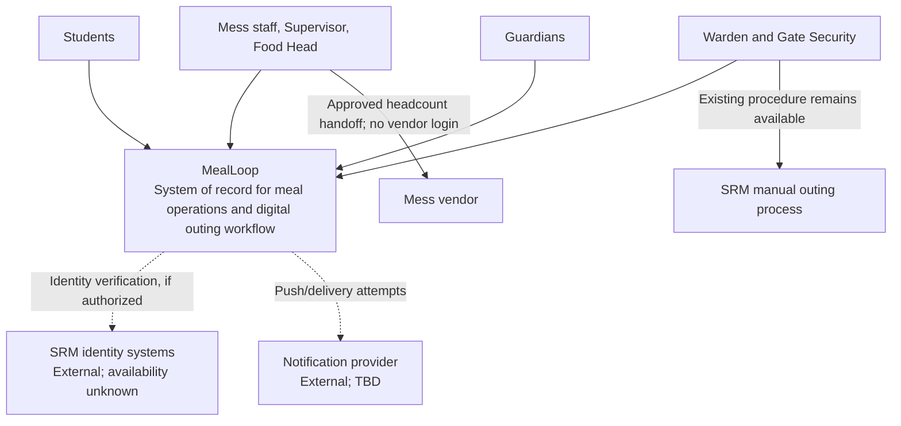
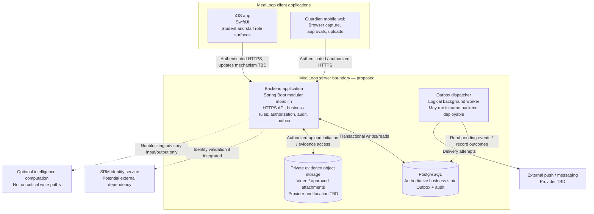

# MealLoop — C4 Architecture (Review Draft)

**Version:** 0.1 · **Date:** 2026-10-24 · **Status:** PROPOSED, not owner-approved or implemented  
**Review sequence:** PRD → NFR → C1 → C2 → C3 → selective C4 → ADRs → data model and API contracts  
**First pilot:** Meenakshi Girls' Mess, SRMIST Kattankulathur

> This is an architecture proposal informed by [PRD v0.2](../PRD.md) and [NFR v0.2](../NFR.md). They are still under owner review. Do not present proposed infrastructure or external integrations as deployed, confirmed, or institutionally authorized. The existing [ADR-002](../adr/ADR-002-backend-shape.md), [backend proposal](../backend/BACKEND_PROPOSAL.md), and [first-slice OpenAPI](../backend/openapi.yaml) remain proposals, not decisions approved by this document.

## What C1 / C2 / C3 / C4 mean

| Level | Question answered | Status in this draft |
|---|---|---|
| **C1 — System Context** | Who uses MealLoop, and what systems does it interact with? | **Drafted below** |
| **C2 — Container** | Which independently deployable applications and data stores form MealLoop? | **Drafted below** |
| **C3 — Component** | Which components/modules inside the backend own each business operation and boundary? | **Not yet approved or diagrammed** |
| **C4 — Code** | How do classes, interfaces and code collaborate inside a selected component? | **Deferred; optional for complex components** |

"C4 model" is the name for all these views. A full class-level diagram is **not** a prerequisite for every feature. A C4 *container* means an application or data store that can execute or deploy separately, not a Docker container.

## C1 — System context

### People and external systems

- **Students:** View menu, submit meal intentions, display entry QR, report issues, view eligible credits, request outings.
- **Mess operations:** Door Scanner, Pass Desk, Kitchen Staff, Supervisor and Food Head/Admin. They act only within authorized scope, except appropriately privileged Admin operations.
- **Hostel operations:** Warden and Gate Security, scoped to their authorized hostel/block and outgoing pass events.
- **Guardians:** Review and accept/reject an outing request via mobile web; acceptance triggers separately handled verification evidence.
- **SRM administrators:** Control institutional approval, identity-source policy, retention, escalation, pilot rollout and access delegation.
- **Vendor:** Receives **approved headcount only** through the authorized management handoff. **No vendor MealLoop account** or automatic food-quantity command.
- **SRM identity service (external, unconfirmed):** A possible source of institution-verified identity, not an integration we can assume exists.
- **Notification delivery services (external, provider TBD):** Push, and any institution-authorized SMS/other delivery channel. Delivery is not the source of truth.
- **Existing hostel outing procedure (external/manual):** Remains available for ineligible students and where digital outing activation is unauthorized.

### Context diagram

**System boundary:** MealLoop owns its product records, authorizations, audit history, and outcomes that its server commits. It does **not** own the vendor's food-production process, guardian's real-world identity, SRM's policies, the campus network, or the external notification provider.

### Context constraints

1. Student intention is not attendance; a QR entry confirms entry, not food served or consumed (PRD DI-1, DI-3, DI-7).
2. Live forecast, Cutoff forecast, Approved headcount, Sent-to-vendor headcount, Actual entries and Final entries are separate facts (FR-HC-002).
3. AI cannot independently grant safety permissions or block core dining (NFR-REL-008).
4. No offline scan or pass check is represented as a digitally recorded success during the pilot (NFR-REL-001, NFR-REL-005); authorized manual continuity is **separate**, with audited reconciliation.
5. Outing activation, guardian video collection, retention and real reward redemption remain subject to SRM approval (NFR-DEP-004).
6. Initial digital outing **pilot eligibility** covers the SRM-authorized cohort without participation/reliability enforcement; post-pilot eligibility requires both based on validated evidence (FR-OUT-024, FR-OUT-028).

## C2 — Container view

**Proposed shape:** one Spring Boot backend deployable with clear internal modules and one PostgreSQL database. This fits the four-person team and one-mess pilot better than mandatory microservices. The architecture remains a proposal until evaluated in ADRs.

### Container diagram

### Container responsibilities and boundaries

| Container | Responsibility | Important restrictions | Decision status |
|---|---|---|---|
| **SwiftUI iOS application** | Role-specific interfaces, accessibility, request and state presentation, demo/API switch | Never commit attendance locally; no protected decision based on device clock; no demo data in release | Client foundation exists; backend integration unimplemented |
| **Guardian mobile web** | Request review, Accept/Reject, chosen-language video capture, interrupted-upload recovery | Verification evidence is not proof of identity; cannot bypass warden; must not publicize media | Proposed application boundary; privacy and browser matrix pending |
| **Backend application** | Identity and scoped authorization, state machines, transactional commands, reporting/query APIs, audit, event recording | No shared four-digit staff password as sole production identity; no synchronous AI dependency in core transactions | Proposed Spring Boot monolith |
| **PostgreSQL** | Canonical records, uniqueness and integrity constraints, audit metadata, outbox | Incomplete data never coerced to zero; approved/forecast/sent/actual/final quantities do not alias | Proposed |
| **Private object storage** | Guardian video and approved attachments | Backend-authorized access only, encryption, retention/deletion policies; location and provider need approval | Proposed; not selected |
| **Outbox dispatcher** | Delivery attempts, retry/backoff, failure tracking, routing/escalation | At-least-once attempts; consumer deduplication; a failed push never deletes the originating event | Logical component; deployment location TBD |
| **Optional intelligence** | Forecast comparisons, optional advisory classification and analysis | Core transactions do not depend on it; no autonomous approval or eligibility determinations | Optional / may remain absent |

**Not asserted:** iOS support for every administrative workflow, hosting provider, autoscaling, broker, Redis, WebSockets, SMS vendor, storage region, hardware scanner integration, or completed integrations.

### Important system sequences (proposed, technology-independent)

**Verified meal entry:**
1. A staff member submits a scan/identifier through the iOS client.
2. Backend authenticates the staff member and validates permission **and assigned mess**.
3. Backend checks the meal's current authoritative state, QR/identity proof and duplicate-entry invariant.
4. One database transaction saves the accepted record and any required auditable event; the unique key prevents concurrent double-counting.
5. Only the successful committed response can display **Recorded**. A timeout may require an idempotent status check before retry; it is never assumed failed or successful.
6. Staff read models and notifications update subsequently. Stale interfaces cannot override server state.

**Admin headcount and vendor handoff:**
1. Capture the live forecast and preserve the cutoff forecast.
2. Authorized Admin approves or adjusts a separately recorded headcount with an audit reason.
3. Authorized Admin transmits **that approved headcount** via a documented vendor communication mechanism.
4. Record the transmitted value, time, actor and delivery evidence/status; an unacknowledged message is not silently labelled delivered.
5. Actual and final entry counts remain independent.

**Guardian outing:**
1. Student request → verified guardian access → Accept or Reject.
2. Only Accept starts the 4–10-second video/verification flow, with supported fallback review.
3. Guardian response and its evidence are stored with scoped access and audit.
4. The assigned authorized Warden makes the final approval decision; no timeout auto-approves.
5. Signed time-limited pass → authoritative Gate exit and return verification. Exact token/security design is deferred.

**SOS and notifications:**
1. Persist SOS case and delivery intent in authoritative records.
2. Make it visible through server queries to assigned staff; attempt notification separately.
3. Distinguish event persistence, UI visibility, provider delivery attempt, human acknowledgment and escalation.
4. Failed notification delivery must not erase the SOS. Urgent real-world danger must retain institutionally approved emergency channels independent of the app.

## C3 — Next design pass (NOT yet accepted)

Proposed **internal** backend component/module candidates; these are NOT C2 deployment containers:

1. **Identity & Access:** principal/session, role assignment, mess/block policy, resource authorization, delegation.
2. **Dining Core:** meals, intentions and cutoff, forecast versions, headcount approval/handoff, attendance entries and special passes.
3. **Mess Operations:** start/close commands, shortages, SOS, waste reports, audit collaboration.
4. **Feedback / Community / Rewards:** report classification and deterministic publication, moderation, credits, coverage-aware eligibility inputs.
5. **Outings:** guardian acceptance and evidence references, warden decision, eligibility modes, signed pass and gate transitions.
6. **Notifications:** transactional outbox, delivery status and escalation.
7. **Optional intelligence boundary:** advisory only, independently replaceable.

Before drawing C3 diagrams, verify **which module owns meal start/close**, since the existing backend proposal lists both Dining Core and Mess Operations responsibilities around meal lifecycle. One state machine must have one clear owner. Also establish no cross-module direct-table writes, and document read/query ownership and transactional boundaries.

### C3 design work to complete

- Component diagrams for the critical **Dining/Entry** and **Outings/Evidence** slices (expand SOS and Community as needed).
- Command/query ownership, cross-module contracts and outbox event definitions.
- Duplicate handling and race conditions (scan vs close, two scanners, gate replay).
- Manual entry/reconciliation provenance and coverage calculations.
- Scoped access at both endpoint and object/file layers.
- Contention and response targets against NFR-REL-004 and NFR-PER-001/002.

## C4 — Code level (selective, later)

Only diagram selected implementation areas when code-level complexity warrants it. Initial candidates:
- `RecordMealEntry` command handler + repository + idempotency/uniqueness tests.
- Meal state machine and server-time cutoff policy.
- Outing approval state machine and gate pass verifier.
- Authorization policy interfaces and evidence access controller.

Do **not** create exhaustive class diagrams from Figma screens or lock class names before component contracts and ADRs are reviewed.

## ADR and contract gates

Required decisions **before freezing** architecture/data schema/API contracts:

| Gate | Needed outcome | Source |
|---|---|---|
| Backend deployment shape and module boundaries | Evaluate proposed Spring Boot modular monolith; explicitly allocate meal lifecycle ownership | [ADR-002 proposed](../adr/ADR-002-backend-shape.md) |
| Transaction integrity and event delivery | Database uniqueness, idempotency-key semantics, outbox, audit, state transitions | NFR-REL-001/002/003/009 |
| Production identity and guardian security | Real staff identity, delegated scopes, verified guardian contact, evidence access and data governance | NFR-SEC-001/002/003; PRD FR-ATT-015, FR-OUT-022 |
| Cross-device updates | Evaluate polling vs streaming against the 5-second provisional refresh target | NFR-REL-004 |
| Storage and recovery | Video location/consent, hosting cost ceiling, availability, RTO/RPO and backup restoration | NFR-PRI-007, NFR-PER-004, NFR-SCL-004 |
| Physical pilot readiness | Connectivity survey, measured entry rate, SOS operational runbooks | NFR-REL-011, NFR-PER-007, NFR-OPS-001 |

### Existing proposed OpenAPI requires follow-up

The first-slice [OpenAPI draft](../backend/openapi.yaml) currently describes a shared four-digit role password as a staff session mechanism, and a simplified headcount resource. Those do **not** satisfy proposed production staff identity (FR-ATT-015, NFR-SEC-001) or the six distinct headcount quantities (FR-HC-002). **Do not deploy it as a production contract unchanged.** The first slice also does not cover Community, Rewards or all outing roles. Reconcile API only **after** module ownership and ADR review.

## Evidence and review checklist

- [ ] C1: Owner confirms actors, external dependencies and institutional boundary.
- [ ] C2: Owner confirms candidate clients, backend/data boundaries, and what remains external.
- [ ] PRD and NFR corrective PRs reviewed and merged in proper stacked order.
- [ ] C3: Backend owner and module dependency contracts reviewed.
- [ ] C3: Cross-role sequences and edge cases tested against functional/NFR traceability.
- [ ] ADRs accepted before treating the proposed backend/database/storage decisions as final.
- [ ] No C4 code diagrams claimed completed without actual class/interface work.
- [ ] No hosting, data residency, security compliance or guardian evidence policy claimed approved.
